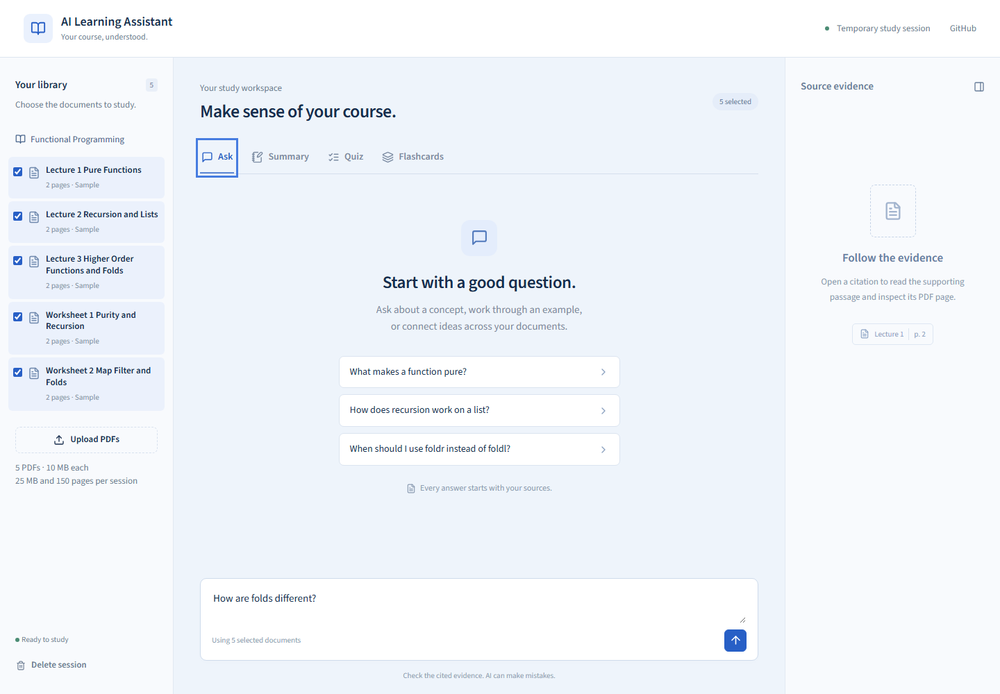

# AI Learning Assistant

Turn course PDFs into cited answers, revision notes, quizzes, and Anki flashcards. A standalone expansion of Bilal Amin's **2025 local prototype**.



## Status

**[Open the live demo](https://ai-learning-assistant-one-sigma.vercel.app)** · [Backend health](https://ai-learning-assistant-api-1aeb.onrender.com/api/health)

The frontend and backend are deployed; final live workflow validation is in progress. The staged v1 evaluation records **30/30 retrieval hits**, **27/30 supported correct answers**, and **10/10 unsupported refusals** under a Codex-assisted manual rubric review. This includes documented rate-limit retries and a focused citation-typography recheck; it is not independent human grading or an untouched single-run benchmark of the final deployed commit. Original failures remain published. See [method](evaluation/README.md), [review](evaluation/results/review-v1.json), and [raw retrieval results](evaluation/results/retrieval-v1.json).

Measured locally on the original ten sample pages: 8.375 seconds to index all five PDFs with embedding files already cached, 285.37 MiB sampled peak process-tree RSS, and 0.75-second median successful model-call latency (retrieval/polling excluded; maximum 36.968 seconds including retry waits). Evaluation model calls consumed 112,153 provider-reported tokens. These are sample-workload measurements, not maximum-load or production-service guarantees. The container sample-startup check also passed under a 512 MiB cap.

The 2025 prototype used Python, LangChain, Streamlit, FastAPI, Llama, and ChromaDB. Its historical 25-document/300+ interaction figures are **not results of this release**. This release uses five newly authored sample documents, ten pages total.

## Run locally

Requirements: Python 3.12, uv, Node.js 22+, and a free Groq API key.

```sh
uv sync --frozen --python 3.12
cp .env.example .env
# Add GROQ_API_KEY to .env. Keep this file private.
uv run uvicorn app.main:app --app-dir backend --env-file .env --host 127.0.0.1 --port 8000 --no-access-log
```

In another terminal:

```sh
cd frontend
npm ci
npm run dev
```

Open http://127.0.0.1:5173. On first startup FastEmbed downloads the embedding model. The interface reports sample preparation until all five PDFs are indexed. Do not expose the local development server publicly.

Set `VITE_API_URL` in `frontend/.env.local` when the backend is elsewhere. Set `ALLOWED_ORIGINS` on the backend to exact frontend origins. Never add the Groq key to frontend variables. `MAX_DOCUMENTS=25` enables the later local document-count configuration; other session resource limits remain enforced.

## Study workflow

1. Try the original Functional Programming sample course or upload text-based PDFs.
2. Select ready documents in the library and ask a question.
3. Open a citation to inspect its passage, physical page number, and PDF preview.
4. Select one document for a full-scope summary, optionally setting a page range.
5. Generate a five-question quiz, submit answers, then review explanations and sources.
6. Generate ten flashcards, flip through them, and export UTF-8 TSV for Anki.
7. Export summary or quiz review Markdown. Delete the session to remove private application data.

## Architecture and API

React/TypeScript/Vite frontend; FastAPI/Pydantic backend; pypdf extraction; PDF.js viewing; FastEmbed `BAAI/bge-small-en-v1.5`; SQLite FTS5 and NumPy hybrid retrieval; Groq `openai/gpt-oss-20b` structured generation. [Architecture](docs/architecture.md), [OpenAPI](openapi.json), [privacy and limits](docs/privacy.md), [deployment](docs/deployment.md).

Chunks stay within pages, target 350 embedding tokens with 50-token overlap, and carry backend-controlled source identifiers. Selected-document and session filters precede retrieval. Reciprocal rank fusion combines semantic and lexical rankings. At most six passages enter chat context. All displayed citations must reference supplied sources and contain actual source text after whitespace normalization. Citation validation establishes provenance, not factual correctness.

Summaries batch the entire selected scope and combine validated batch sections without dropping citations. Missing batches or unreadable pages are explicitly marked incomplete. Quizzes and cards sample across the selected scope; they do not claim exhaustive coverage.

## Validation

```sh
uv run pytest -q
uv run ruff check backend scripts
PYTHONPATH=backend uv run python scripts/openapi.py
cd frontend
npm run api:types
npm test
npm run build
npx playwright install chromium
npm run test:e2e
```

Start the backend before running Playwright. Browser tests use real sample documents and the real source endpoints; the quiz/card test stubs the generation API boundary and makes no model-quality claim. The live smoke script, `uv run python scripts/smoke.py`, requires a valid backend Groq configuration and consumes its free allowance.

Rebuild samples: `uv run python scripts/build_samples.py`. Editable course source and its CC BY 4.0 license are in `backend/samples/source` and `backend/samples/LICENSE.md`.

## Limits and exclusions

Five private PDFs, 10 MB each, 25 MB/150 pages per session. No OCR, handwriting, accounts, permanent libraries, collaboration, or spaced repetition. Two-hour idle and 24-hour absolute expiry. Free-host sleep/restart may remove private sessions sooner. A failed extraction may leave a failed document entry until removed, but partial indexed text and the uploaded PDF are removed on failure.

Model/provider quotas and free hosting make this a portfolio demonstration rather than a production service. No automatic paid upgrade is configured. Real deployment, cold-start recovery, container memory, and answer-quality gates must pass before declaring the MVP released.
