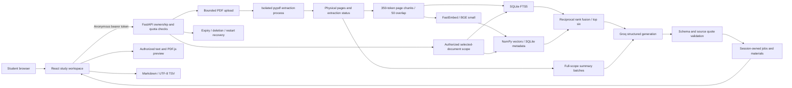

# Architecture

One web worker and one indexing lock avoid duplicating the embedding model. A generation lock bounds model concurrency. The index uses one SQLite connection protected by a reentrant lock. Private files use random server identifiers; original filenames are metadata, never filesystem paths. Sample PDFs are build artifacts and reindex automatically into a new temporary store.

No database or uploaded data lives in the frontend. The model key exists exclusively in backend environment variables. No question or document contents are written to logs. Timing/usage logs contain only numeric measurements and error categories.
